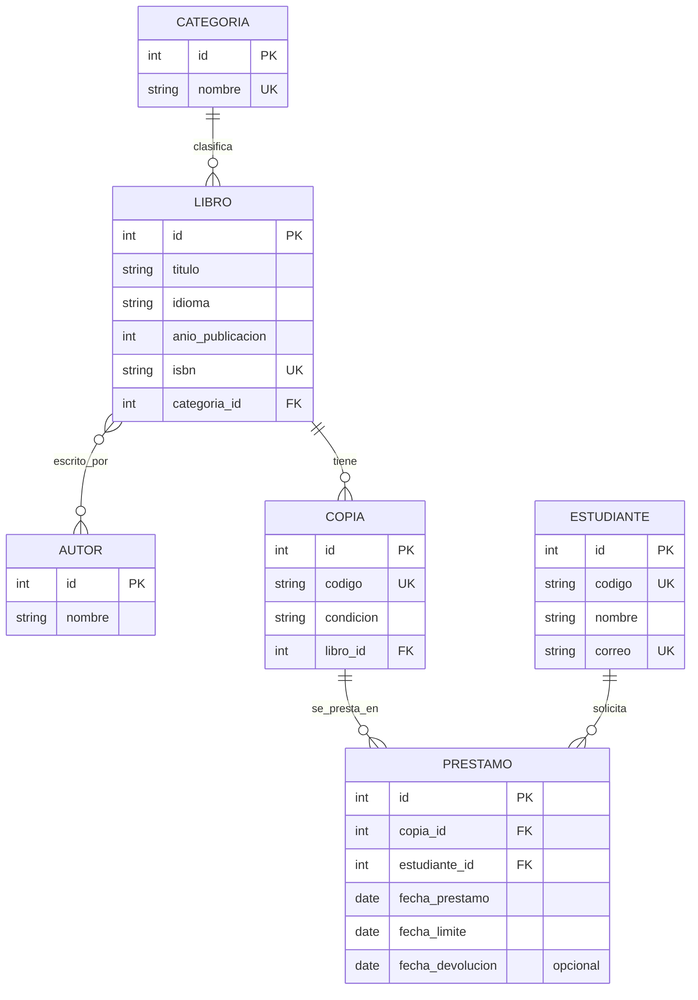

# Biblioteca UFPS

## 1. Título y descripción

Sistema para llevar los préstamos de una biblioteca universitaria, hecho con Django. Reemplaza los cuadernos de la bibliotecaria: guarda libros, autores, categorías, copias físicas, estudiantes y préstamos, y ofrece un panel de administración para manejarlos sin conocimientos técnicos.

Actividad de Programación Web, UFPS.

---

## 2. Tecnologías

| Componente | Versión |
|---|---|
| Python | 3.12.6 |
| Django | 6.1.2 |
| Base de datos | SQLite (la que trae Django por defecto, archivo `db.sqlite3`) |

---

## 3. Instalación y ejecución

1. Clonar el repositorio:
   ```
   git clone URL_DEL_REPOSITORIO
   cd biblioteca-ufps
   ```
2. Crear y activar el entorno virtual.

   Windows:
   ```
   python -m venv .venv
   .venv\Scripts\activate
   ```
   Mac o Linux:
   ```
   python -m venv .venv
   source .venv/bin/activate
   ```
3. Instalar las dependencias:
   ```
   pip install -r requirements.txt
   ```
4. Crear las tablas:
   ```
   python manage.py migrate
   ```
5. Crear un superusuario (elige tu propio usuario y contraseña):
   ```
   python manage.py createsuperuser
   ```
6. (Opcional) Cargar datos de prueba:
   ```
   python cargar_datos.py
   ```
7. Arrancar el servidor y entrar a `http://127.0.0.1:8000/admin`:
   ```
   python manage.py runserver
   ```

El archivo `db.sqlite3` no se sube al repositorio, así que quien clone el proyecto parte de una base vacía y debe crear su propio superusuario.

---

## 4. Estructura del proyecto

```
biblioteca-ufps/
├── config/             Configuración del proyecto (settings.py, urls.py)
├── biblioteca/         La app
│   ├── models.py       Los seis modelos y la restricción de préstamo activo
│   ├── admin.py        Personalización del panel de administración
│   └── migrations/     Historial de cambios de la base de datos
├── cargar_datos.py     Script que crea los datos de prueba de la fase 5
├── manage.py           Punto de entrada para los comandos de Django
├── requirements.txt    Librerías necesarias
├── .gitignore          Excluye .venv, __pycache__ y db.sqlite3
└── README.md
```

---

## 5. Modelo de datos



### Relaciones

- **Categoría → Libro (uno a muchos):** una categoría agrupa muchos libros y cada libro tiene una sola categoría. Usa `PROTECT`: no se puede borrar una categoría que tenga libros.
- **Libro ↔ Autor (muchos a muchos):** un libro puede tener varios autores y un autor varios libros. Django crea solo la tabla intermedia (`Libro_autores`).
- **Libro → Copia (uno a muchos):** de un mismo libro hay varias copias físicas, cada una con su código de inventario y su condición. Usa `PROTECT`.
- **Copia → Préstamo (uno a muchos):** una copia se presta muchas veces a lo largo del tiempo. Usa `PROTECT`.
- **Estudiante → Préstamo (uno a muchos):** un estudiante hace muchos préstamos y se conserva su historial, por eso se usa `PROTECT`.

Un estudiante pide prestada una **copia** y no el libro en abstracto, por eso el préstamo apunta a `Copia` y no a `Libro`.

### La regla de la copia prestada

> "Una copia no puede estar prestada a dos personas al mismo tiempo."

Elegimos una **restricción en la base de datos** (`UniqueConstraint` con `condition`) y no una validación con `clean()`:

```python
models.UniqueConstraint(
    fields=["copia"],
    condition=models.Q(fecha_devolucion__isnull=True),
    name="una_copia_un_prestamo_activo",
    violation_error_message="Esta copia ya está prestada y no ha sido devuelta.",
)
```

La unicidad de `copia` aplica solo a los préstamos **sin fecha de devolución** (los activos). Así una copia puede prestarse muchas veces a lo largo del tiempo, pero nunca a dos personas a la vez.

**Por qué la elegimos:** la base de datos la hace cumplir sin importar desde dónde se guarde el dato (admin, shell, scripts). `clean()` solo se ejecuta desde formularios y el admin, o si se llama a `full_clean()` a mano; con `.save()` en el shell se salta. Además, `clean()` revisa y guarda en dos pasos, por lo que dos guardados simultáneos podrían pasar la revisión, mientras que la base de datos revisa y guarda en un solo paso. Una desventaja es que la regla queda en la base de datos y no en el código Python.

**Prueba de que funciona:**

**En el shell.** `UFPS-006` ya tiene un préstamo activo (de Marta Gómez). Se intentó prestarla a otro estudiante:

```python
from datetime import date, timedelta

copia = Copia.objects.get(codigo="UFPS-006")
estudiante = Estudiante.objects.get(codigo="1152004")
Prestamo.objects.create(copia=copia, estudiante=estudiante, fecha_limite=date.today() + timedelta(days=7))
```

- **Predicción:** falla con un `IntegrityError` y no se crea el préstamo.
- **Resultado:** falló, como se esperaba:

```
django.db.utils.IntegrityError: UNIQUE constraint failed: biblioteca_prestamo.copia_id
```

**En el admin.** Al intentar crear un préstamo de una copia que ya está prestada, el formulario no se guarda y muestra: *"Por favor, corrija el siguiente error. Esta copia ya está prestada y no ha sido devuelta."*

**Diferencia entre los dos lugares:** en el admin Django revisa la restricción antes de guardar y muestra nuestro `violation_error_message`; en el shell no hay formulario, así que quien rechaza el dato es la base de datos con un `IntegrityError`. En ambos casos el préstamo duplicado no se crea.

---

## 6. Panel de administración

Cada personalización responde a una necesidad de la bibliotecaria:

| Personalización | Necesidad que resuelve |
|---|---|
| `search_fields` en estudiantes (código y nombre) | Encontrar a un estudiante escribiendo cualquiera de los dos datos |
| Columna "¿Devuelto?" (✔/✘) en préstamos | Ver de un vistazo qué préstamos siguen pendientes, sin interpretar fechas vacías |
| `list_filter` por fechas en préstamos | Acotar la lista por fecha de préstamo y de devolución |
| `autocomplete_fields` en préstamos (copia y estudiante) | Registrar un préstamo buscando por título o código, en vez de un desplegable largo |
| `__str__` de la copia: "Título - código" | No confundir copias de libros distintos, ni copias del mismo libro entre sí |
| `CopiaInline` dentro del libro | Agregar y ver las copias de un libro en la misma página |
| `readonly_fields = ("fecha_prestamo",)` | Que la fecha que se pone sola al crear el préstamo no se edite por error |
| Acción "Marcar préstamos como devueltos" | Devolver varios préstamos de una vez; solo afecta a los que aún no tienen fecha de devolución |
| `list_select_related` en préstamos, copias y libros | Evitar consultas repetidas al mostrar las listas (ver sección 8) |
| Columna de autores en la lista de libros | Ver quién escribió cada libro sin abrirlo |

`list_display`, `search_fields` y `list_filter` están configurados en los modelos Libro, Copia y Préstamo, y todos los modelos tienen un `__str__` legible.

---

## 7. Consultas del ORM

Las consultas se ejecutaron en `python manage.py shell`. Para cada una se muestra el código, lo que se predijo y lo que devolvió. Los datos de prueba se cargaron con `cargar_datos.py` y se sumaron a los que ya existían en la base.

Imports usados:

```python
from datetime import date
from django.db.models import Count
from biblioteca.models import Autor, Categoria, Libro, Copia, Estudiante, Prestamo
```

### Reto 1. Crear un autor, un libro y dos copias

```python
autor = Autor.objects.create(nombre="J. R. R. Tolkien")
categoria = Categoria.objects.get(nombre="Fantasia")
libro = Libro.objects.create(titulo="El Hobbit", idioma="Español", anio_publicacion=1937, isbn="978-0-00-000099-9", categoria=categoria)
libro.autores.add(autor)
Copia.objects.create(codigo="UFPS-101", condicion="nuevo", libro=libro)
Copia.objects.create(codigo="UFPS-102", condicion="usado", libro=libro)
```

- **Predicción:** cada `create` devuelve el objeto creado, y `.add()` no devuelve nada.
- **Resultado:** `create` de las copias devolvió `<Copia: El Hobbit - UFPS-101>` y `<Copia: El Hobbit - UFPS-102>`; `.add()` no imprimió nada.
- **Diferencia:** al buscar `"Fantasía"` (con tilde) salió `Categoria.DoesNotExist`, porque la categoría estaba guardada sin tilde. Con `"Fantasia"` funcionó. Aprendimos que `get()` exige coincidencia exacta.

### Reto 2. Libros de un autor, buscando al autor por su nombre

```python
Libro.objects.filter(autores__nombre="Gabriel García Márquez")
```

- **Predicción:** un QuerySet con los 3 libros de García Márquez.
- **Resultado:** `<QuerySet [<Libro: Cien años de soledad>, <Libro: Antología de ensayos latinoamericanos>, <Libro: Crónica de una muerte anunciada>]>`. Coincide.

### Reto 3. Libros cuyo título contiene una palabra

```python
Libro.objects.filter(titulo__icontains="abiertas")
```

- **Predicción:** un QuerySet con "Las venas abiertas de América Latina".
- **Resultado:** `<QuerySet [<Libro: Las venas abiertas de América Latina>]>`. Coincide. Aunque tiene un solo elemento, sigue siendo un QuerySet.

### Reto 4. Copias disponibles (sin préstamo activo)

```python
Copia.objects.exclude(id__in=Prestamo.objects.filter(fecha_devolucion__isnull=True).values("copia"))
```

La consulta de adentro obtiene los ids de las copias que tienen un préstamo activo (sin fecha de devolución). `.values("copia")` deja solo esa columna; sin ella, Django compararía contra los ids de los préstamos y no contra los de las copias. La de afuera pide todas las copias menos esas.

- **Predicción (con los datos tal como estaban en este reto):** las copias cuyos préstamos están todos devueltos (`2234`, `UFPS-002`, `UFPS-005`) más las que nunca se han prestado (`UFPS-004`, `UFPS-007`, `UFPS-008`, `UFPS-101`, `UFPS-102`): 8 copias. Quedan fuera `UFPS-001`, `UFPS-003` y `UFPS-006`, que tenían un préstamo activo.
- **Resultado:**

```
<QuerySet [<Copia: El principito - 2234>, <Copia: Cien años de soledad - UFPS-002>, <Copia: Ingeniería de Software - UFPS-004>, <Copia: Las venas abiertas de América Latina - UFPS-005>, <Copia: Antología de ensayos latinoamericanos - UFPS-007>, <Copia: Crónica de una muerte anunciada - UFPS-008>, <Copia: El Hobbit - UFPS-101>, <Copia: El Hobbit - UFPS-102>]>
```

- **Comparación:** coincide con la predicción: 8 copias. `UFPS-001` no aparece porque en ese momento todavía tenía un préstamo activo.
- **Intento inicial:** la primera versión, `Copia.objects.exclude(prestamo__fecha_devolucion__isnull=True)`, devolvió solo 3 copias (`2234`, `UFPS-002` y `UFPS-005`) y dejaba fuera las que nunca se han prestado, que también están disponibles. Al excluir por `isnull=True` a través de la relación, esas copias también quedaban excluidas. Lo notamos al comparar el resultado con la lista de copias del admin.

### Reto 5. Estudiantes con al menos un préstamo activo, sin repetir

```python
Estudiante.objects.filter(prestamo__isnull=False, prestamo__fecha_devolucion__isnull=True).distinct()
```

- **Predicción:** Marta Gómez y Luis Pérez.
- **Resultado:** `<QuerySet [<Estudiante: 1152002 - Luis Pérez>, <Estudiante: 1152003 - Marta Gómez>]>`. Coincide.
- **Diferencia durante el trabajo:** la primera versión, sin `prestamo__isnull=False`, habría traído también a los estudiantes sin ningún préstamo (Carlos y Mimi), porque en el JOIN su fecha de devolución también aparece vacía. Se corrigió pidiendo explícitamente que tengan un préstamo y que ese préstamo esté sin devolver. `distinct()` evita que Marta salga dos veces, ya que tiene dos préstamos activos.

### Reto 6. Cuántos préstamos ha hecho cada estudiante

```python
Estudiante.objects.annotate(total=Count("prestamo")).values("nombre", "total")
```

- **Predicción:** un QuerySet con el total de cada estudiante, incluidos los que tienen 0.
- **Resultado:** `<QuerySet [{'nombre': 'Ana Rojas', 'total': 2}, {'nombre': 'Luis Pérez', 'total': 2}, {'nombre': 'Marta Gómez', 'total': 2}, {'nombre': 'Carlos Díaz', 'total': 0}, {'nombre': 'Mimi', 'total': 0}, {'nombre': 'yulian ortega', 'total': 1}]>`. Coincide. `annotate` no descarta a los estudiantes con 0 préstamos.

### Reto 7. Libro más prestado

```python
Libro.objects.annotate(total=Count("copia__prestamo")).order_by("-total").first()
```

- **Predicción:** un solo objeto, "Cien años de soledad", con 3 préstamos.
- **Resultado:** `<Libro: Cien años de soledad>`. Coincide. `first()` devuelve un objeto y no un QuerySet.

### Reto 8. Estudiantes que nunca han pedido un préstamo

```python
Estudiante.objects.filter(prestamo__isnull=True)
```

- **Predicción:** Carlos y Mimi.
- **Resultado:** `<QuerySet [<Estudiante: 1152478 - Mimi>, <Estudiante: 1152004 - Carlos Díaz>]>`. Coincide.

### Reto 9. Marcar un préstamo como devuelto

```python
prestamo = Prestamo.objects.get(copia__codigo="UFPS-001", estudiante__codigo="1152002", fecha_devolucion__isnull=True)
prestamo.fecha_devolucion
prestamo.fecha_devolucion = date.today()
prestamo.save()
Prestamo.objects.get(pk=prestamo.pk).fecha_devolucion
```

- **Predicción:** antes del cambio la fecha es `None`; al final, la fecha de hoy leída desde la base de datos.
- **Resultado:** la fecha era `None` (el shell no imprime nada cuando el valor es `None`) y al final devolvió `datetime.date(2026, 11, 22)`. Coincide. Se comprobó volviendo a leer el préstamo desde la base de datos, y no la variable en memoria.

### Reto 10. Borrar un autor

```python
a = Autor.objects.get(nombre="Eduardo Galeano")
a.delete()
Libro.objects.filter(titulo__icontains="abiertas")
Libro.objects.get(titulo__icontains="abiertas").autores.all()
```

- **Predicción:** los libros no se eliminan; solo se pierde el vínculo.
- **Resultado:** `(3, {'biblioteca.Libro_autores': 2, 'biblioteca.Autor': 1})`. El libro seguía existiendo y su lista de autores quedó en `<QuerySet []>`.
- **Explicación:** Django eliminó 1 autor y 2 vínculos de la tabla intermedia `Libro_autores`. Ningún libro se eliminó porque un `ManyToManyField` no usa `on_delete`: no hay una clave foránea en el libro que quede apuntando a un autor inexistente, así que solo se borra el vínculo. Si el autor estuviera en una `ForeignKey` desde `Libro`, ahí sí dependería del `on_delete` elegido.

---

## 8. Optimización de consultas

El problema N+1: al recorrer una lista y acceder en cada vuelta a un objeto relacionado, Django hace una consulta para la lista y una más por cada elemento.

### Caso 1. Préstamos con estudiante y libro (`select_related`)

Antes:

```python
with CaptureQueriesContext(connection) as ctx:
    for p in Prestamo.objects.all():
        print(p.estudiante.nombre, p.copia.libro.titulo)
print(len(ctx), "consultas")
```

Después:

```python
with CaptureQueriesContext(connection) as ctx:
    for p in Prestamo.objects.select_related("estudiante", "copia__libro"):
        print(p.estudiante.nombre, p.copia.libro.titulo)
print(len(ctx), "consultas")
```

El préstamo no apunta directamente al libro, sino a la copia, y la copia al libro. Por eso hay tres consultas por préstamo (estudiante, copia y libro), además de la consulta inicial: con 7 préstamos, `1 + 3 × 7 = 22`. La predicción inicial fue 21 porque olvidamos contar la consulta que trae la lista de préstamos.

### Caso 2. Libros con sus autores (`prefetch_related`)

Antes:

```python
with CaptureQueriesContext(connection) as ctx:
    for l in Libro.objects.all():
        print(l.titulo, [a.nombre for a in l.autores.all()])
print(len(ctx), "consultas")
```

Después:

```python
with CaptureQueriesContext(connection) as ctx:
    for l in Libro.objects.prefetch_related("autores"):
        print(l.titulo, [a.nombre for a in l.autores.all()])
print(len(ctx), "consultas")
```

Antes se hace una consulta por libro (`1 + 7 = 8`). Con `prefetch_related` son siempre 2: una para los libros y otra para los autores de todos ellos, que Django une en Python. La predicción inicial fue 1, y falló porque `prefetch_related` hace una consulta aparte para la relación en lugar de un JOIN.

### Tabla de resultados

| Consulta | Predicción | Antes | Después |
|---|---|---|---|
| Préstamos con estudiante y libro | 21 | 22 | 1 |
| Libros con sus autores | 8 | 8 | 2 |

### ¿Por qué `select_related` no sirve para libros y autores?

`select_related` funciona con relaciones que dan **un solo objeto** (una `ForeignKey`), porque une las tablas con un JOIN y cada fila trae un único objeto relacionado. Entre libros y autores la relación es de muchos a muchos: un libro tiene varios autores y un autor puede serlo de varios libros, y un JOIN repetiría el libro una vez por autor. Por eso se usa `prefetch_related`, que hace una consulta de libros y otra de autores y las une en Python.

### Optimización en el admin

Se aplicó la misma idea en el panel: `list_select_related` en las listas de préstamos (`copia__libro`, `estudiante`), copias (`libro`) y libros (`categoria`). Para la columna de autores de la lista de libros, que es de muchos a muchos, se sobrescribió `get_queryset` con `prefetch_related("autores")`, porque no existe un atajo equivalente.

---

## 9. Uso de inteligencia artificial

Usamos **Claude** (Anthropic) como apoyo durante toda la actividad.

**Qué le pedimos:**
- Explicaciones de conceptos (constraints, `clean()`, `__str__`, N+1, `select_related` y `prefetch_related`, lookups).
- Revisión de nuestro `models.py` y `admin.py` contra los requisitos de la actividad.
- Un script para cargar los datos de prueba (`cargar_datos.py`), que leímos completo antes de ejecutarlo.
- Un borrador del diagrama Mermaid a partir de nuestro `models.py`.
- Orientación para organizar este README.

**Qué tuvimos que corregir o verificar:**
- Las consultas del ORM las escribimos nosotras y las ejecutamos en el shell, con nuestra propia predicción antes de ejecutar. Cuando una predicción de la IA no coincidió con el resultado, nos quedamos con el resultado real.
- La IA afirmó que cada estudiante tenía como máximo un préstamo activo, y era falso: Marta tiene dos. Lo notamos al leer el script y comparar con los datos.
- La IA predijo que la consulta del reto 4 devolvería también las copias nunca prestadas, y no fue así. Nos dimos cuenta al comparar el resultado con la predicción, y esto nos llevó a revisar la consulta.
- El script de datos asumía nombres de carpetas y de modelos; verificamos que coincidieran con los de nuestro proyecto.
- **Diagrama:** lo revisamos contra el código con la lista de la actividad (modelos completos, sentido de cada `ForeignKey`, `ManyToManyField` como una sola línea, y `fecha_devolucion` como único campo opcional) y **no encontramos errores**.

---

## 10. Equipo y reflexión

**Integrantes:**

- Yulian Andrés Ortega Machado
- Julián Andrés Izquierdo Gallardo
- María José Osorio Ovallos

### ¿Qué parte de su diseño cambió después de escribir las primeras consultas, y por qué?

Los modelos no cambiaron, pero ajustamos el admin al ver cómo se comportaban las consultas: agregamos `list_select_related` en las listas de préstamos, copias y libros para evitar el N+1, y una columna de autores en la lista de libros para que se entendiera mejor cada registro. Las consultas también nos corrigieron ideas: la del reto 5 traía estudiantes sin préstamos por culpa del JOIN, y el reto 10 nos mostró que borrar un autor deja libros sin autores, porque un muchos a muchos no usa `on_delete`.

### ¿En qué se equivocó el agente con el diagrama y cómo lo notaron?

En el diagrama no encontramos errores: están los seis modelos, las cardinalidades van en el sentido correcto, el muchos a muchos es una sola línea y `fecha_devolucion` es el único campo opcional. Lo comprobamos comparando el diagrama con `models.py`. Donde sí se equivocó el agente fue en otras partes del trabajo, descritas en la sección 9.

### ¿Qué decisión defenderían ante otro grupo y cuál cambiarían?

**Defenderíamos** la restricción en la base de datos para la regla de la copia prestada, porque protege el dato desde cualquier punto de entrada, y las optimizaciones del N+1, que medimos con números (22 → 1 y 8 → 2 consultas).

**Cambiaríamos**, si empezáramos de nuevo, detalles del modelo: `Autor.nombre` no es único y se podría crear dos veces el mismo autor; un libro puede quedar sin autores y nada lo impide; y `fecha_limite` se escribe a mano cuando podría calcularse por defecto a partir de la fecha del préstamo. En el admin, también mostraríamos los libros de cada autor.
